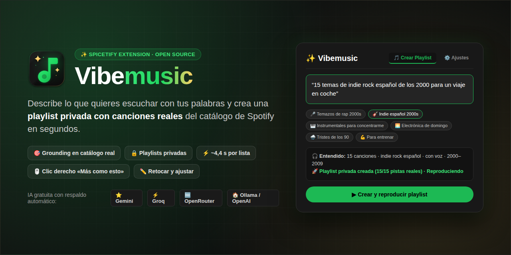
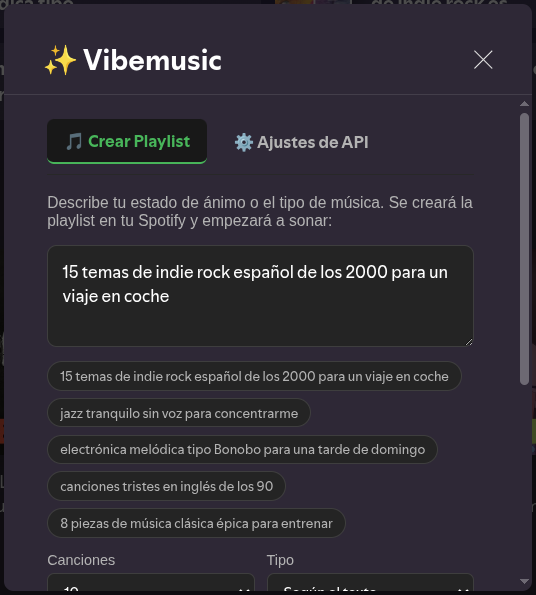

<div align="center">
  
  <br /><br />
  <a href="LICENSE"></a>
  
  
</div>

#  Vibemusic

<p align="center"><a href="README.md">English</a> · <b>Español</b></p>

**Describe lo que quieres escuchar con tus palabras y Vibemusic crea la playlist en tu Spotify, con canciones reales del catálogo.**



> Extensión **no oficial** para [Spicetify](https://spicetify.app). No está afiliada a Spotify ni a Spicetify.

## Qué hace

Escribes algo como *"15 temas de indie rock español de los 2000 para un viaje en coche"* y Vibemusic:

1. **Entiende la petición**: cantidad, género, época, idioma, con o sin voz, ambiente y artistas de referencia o a evitar.
2. **Busca candidatas reales en Spotify** y deja que una IA elija entre ellas, para que no invente canciones que no existen.
3. **Crea una playlist privada** y empieza a sonar. Antes de buscar te enseña qué ha entendido ("Entendido: 15 canciones · indie rock español · 2000–2009 · …").

## Características

- 🗣️ **Lenguaje natural**: "diez canciones tristes en inglés de los 90", "jazz sin voz para concentrarme", "electrónica tipo Bonobo, pero sin Bonobo".
- 🎯 **Respeta lo que pides**: la época se filtra en el propio buscador de Spotify, y se descartan duplicados, versiones demo/acústicas/remix (salvo que las pidas) y el relleno de palabras clave ("Relaxing Music for Study…").
- 🎨 **Variedad**: como mucho 2 canciones por artista, salvo que pidas "solo de X".
- 🖱️ **Clic derecho**:
  - en una canción o playlist → **"Vibemusic: más como esto"**;
  - en una playlist creada por Vibemusic → **"Vibemusic: mostrar prompt de la lista"** (lee el historial local o directamente la descripción de la playlist en Spotify).
- ✏️ **Ajustar y recientes**: retoca tu última playlist (*"más oscuro"*, *"sin remixes"*, conservado entre sesiones), reutiliza tus últimos prompts desde **🕘 Recientes** o cancela una búsqueda en marcha con **⏹ Cancelar**.
- 🔒 **Privada por defecto**: la playlist no se publica en tu perfil.
- 🆓 **Funciona con planes gratuitos** de Google Gemini, Groq u OpenRouter, o con cualquier API compatible con OpenAI (Mistral, Cerebras, Ollama…). Si un proveedor falla, prueba el siguiente.

## Requisitos

- Spotify de escritorio con [Spicetify](https://spicetify.app/docs/advanced-usage/installation) instalado.
- Una clave de API **gratuita** de al menos un proveedor (ver [Configuración](#configuración)).

Probado con Spotify 1.2.95 y Spicetify 2.46.7 en Linux. Si lo usas en otra versión o sistema y te funciona (o no), [cuéntalo](https://github.com/D4vRAM369/spicetify-vibemusic/issues).

## Instalación

### Opción A — Spicetify Marketplace

Busca **Vibemusic** en la pestaña *Marketplace → Extensions* e instálala.

### Opción B — Manual

1. Descarga [`vibemusic.js`](https://raw.githubusercontent.com/D4vRAM369/spicetify-vibemusic/main/vibemusic.js).
2. Cópialo a la carpeta `Extensions` de Spicetify. Para saber dónde está en tu equipo:

   ```bash
   spicetify path userdata
   ```

   Dentro de esa carpeta, entra en `Extensions` (créala si no existe) y pega el archivo.

3. Actívala y aplica los cambios (Spotify se reiniciará):

   ```bash
   spicetify config extensions vibemusic.js
   spicetify apply
   ```

Aparecerá un botón con una **nota musical ✨** en la barra superior de Spotify.

## Configuración

La primera vez se abre **⚙️ Ajustes de API**. Configura al menos un proveedor:

| Proveedor | Dónde conseguir la clave gratis | Consejo |
|---|---|---|
| **Google Gemini** (recomendado: el que más sabe de música) | [aistudio.google.com/apikey](https://aistudio.google.com/apikey) | Crea la clave en un proyecto **sin facturación**: así nunca puede generar cargos |
| **Groq** (muy rápido) | [console.groq.com/keys](https://console.groq.com/keys) | Plan gratuito, sin tarjeta |
| **OpenRouter** | [openrouter.ai/keys](https://openrouter.ai/keys) | Usa modelos 🆓 y ponle un límite de crédito a la clave |
| **Personalizado** | Cualquier API compatible con OpenAI | Escribe la URL base (p. ej. `https://api.mistral.ai/v1`) |

1. Pega la clave, elige el modelo en el desplegable y pulsa **🔌 Probar conexión**.
2. Elige el **proveedor principal**. Los demás que configures sirven de respaldo automático.
3. **💾 Guardar ajustes**.

## Uso

1. Pulsa el botón ✨ de la barra superior.
2. Escribe lo que quieres escuchar, o pulsa uno de los ejemplos.
3. Ajusta si quieres **Canciones** (cantidad), **Tipo** (con o sin voz) y **Curaduría** (joyas ocultas, equilibrado o clásicos). Un número escrito en el texto ("los 10 mejores…") tiene prioridad sobre el selector.
4. **Crear y reproducir playlist**, o **Ctrl+Enter**.

Si no se consigue la cantidad pedida, el modal dice cuántas se pidieron, encontraron y añadieron, y por qué se descartó cada una.

## Privacidad y seguridad

- **Lo que se envía:** el texto de tu petición, y los nombres de canciones candidatas, al proveedor de IA que configures. Nada más. Vibemusic no tiene servidor propio.
- **Playlists privadas:** se crean fuera de tu perfil y como privadas. El prompt se guarda en la descripción solo si la playlist quedó privada.
- **Claves:** se guardan en el almacenamiento local de Spotify en tu equipo. ⚠️ **Otras extensiones de Spicetify pueden leer ese almacenamiento**, y no hay forma técnica de impedirlo, porque todas se ejecutan en la misma página. Por eso usa **claves gratuitas o con límite de gasto**, una clave solo para Vibemusic, y revócala en la web del proveedor si sospechas de alguna extensión. En Ajustes tienes **🗑️ Borrar todas las claves**.

## Limitaciones conocidas

- Usa **APIs internas** de Spotify y Spicetify (búsqueda GraphQL, `PlaylistAPI`, `RootlistAPI`…), que pueden cambiar con una actualización de Spotify.
- Los **planes gratuitos** tienen límites por minuto y por día. Si se agotan, verás un aviso y se usará el siguiente proveedor configurado.
- Spotify no indica si una canción tiene voz: en "sin voz" se confía en lo que declara la IA.
- La calidad depende del modelo: Gemini conoce mejor la música de nicho que los modelos más pequeños.

## Problemas comunes

| Síntoma | Solución |
|---|---|
| "el modelo … ya no existe" | El proveedor retiró ese modelo: elige otro en el desplegable |
| "límite de uso alcanzado" / 429 | Cuota gratuita agotada: espera o configura otro proveedor de respaldo |
| Ollama local no carga modelos | Arranca Ollama con `OLLAMA_ORIGINS=https://xpui.app.spotify.com` |
| El botón no aparece | `spicetify config extensions` debe listar `vibemusic.js`; luego `spicetify apply` |

## Desinstalar

```bash
spicetify config extensions vibemusic.js-
spicetify apply
```

Después borra `vibemusic.js` de la carpeta `Extensions`. Las playlists creadas siguen en tu biblioteca.

## Contribuir

Las sugerencias y correcciones son bienvenidas. Lee [CONTRIBUTING.md](CONTRIBUTING.md). Para errores, abre un [issue](https://github.com/D4vRAM369/spicetify-vibemusic/issues/new/choose) con la plantilla.

```bash
node --test   # pruebas de la lógica (no necesitan Spotify)
```

## Licencia

[MIT](LICENSE) © D4vRAM369
