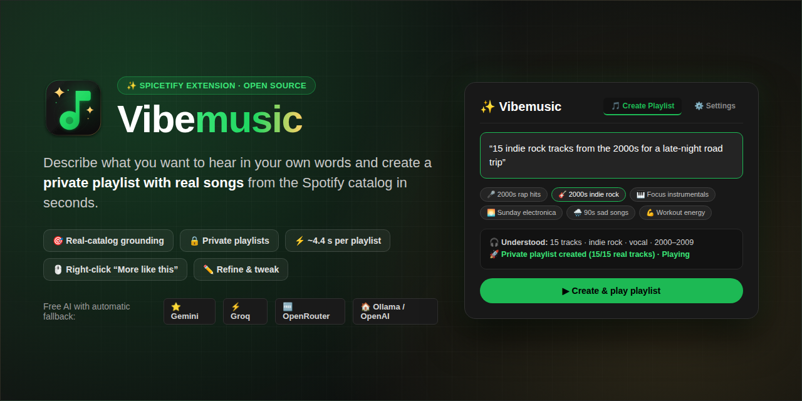
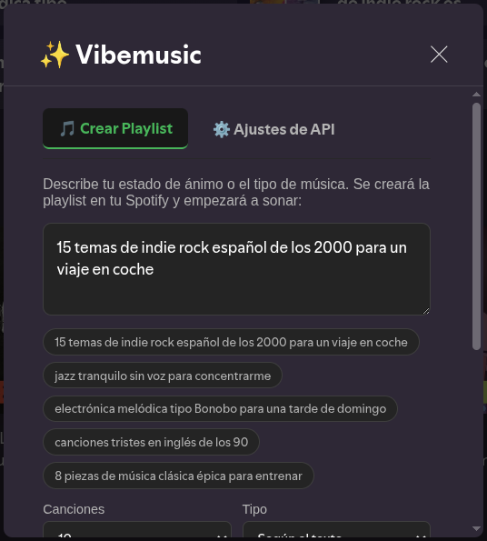

<div align="center">
  
  <br /><br />
  <a href="LICENSE"></a>
  
  
</div>

#  Vibemusic

<p align="center"><b>English</b> · <a href="README-ES.md">Español</a></p>

**Describe what you want to hear in your own words and Vibemusic creates the playlist in your Spotify, using real catalog tracks.**



> **Unofficial** extension for [Spicetify](https://spicetify.app). Not affiliated with Spotify or Spicetify. *(Note: the in-app modal UI is currently in Spanish, while prompts work in any language.)*

## What it does

Type something like *"15 indie rock tracks from the 2000s for a late-night road trip"* and Vibemusic:

1. **Understands your request**: track count, genre, era/year range, language, vocal vs. instrumental, mood, reference artists, and excluded artists.
2. **Searches Spotify for real candidate tracks first** (*catalog grounding*) and lets the AI pick from that verified pool, so it doesn't hallucinate non-existent songs.
3. **Creates a private playlist** and starts playing it immediately. Before searching, it shows you what it understood (*"Entendido: 15 canciones · indie rock · 2000–2009 · …"*).

## Features

- 🗣️ **Natural language**: *"10 sad songs in English from the 90s"*, *"instrumental jazz with no vocals to focus"*, *"electronic music like Bonobo, but without Bonobo"*.
- 🎯 **Strict constraint matching**: year ranges are filtered directly in Spotify's search (`year:`), splitting multi-year ranges evenly so recent years don't drown out older ones. Duplicates, demo/acoustic/remix versions (unless requested), and keyword-stuffed filler (*"Relaxing Music for Study…"*) are automatically filtered out.
- 🎨 **Artist variety**: capped at 2 tracks per artist by default (3 for 20+ track playlists), or unlimited when you ask specifically for tracks by a given artist.
- 🖱️ **Right-click context menu**:
  - on any track or playlist → **"Vibemusic: más como esto"** (*more like this*);
  - on any playlist created by Vibemusic → **"Vibemusic: mostrar prompt de la lista"** (*show playlist prompt*, reading from local history or directly from the Spotify playlist description).
- ✏️ **Refine & Recent prompts**: tweak your last generated playlist (*"darker"*, *"no remixes"*, persisted across sessions), reuse your latest prompts from **🕘 Recientes**, or abort an active generation anytime with **⏹ Cancelar**.
- 🔒 **Private by default**: generated playlists are not published to your public profile.
- 🆓 **Works with free API tiers** from Google Gemini, Groq, or OpenRouter, or any OpenAI-compatible server (Mistral, Cerebras, local Ollama / LM Studio…). If one provider fails or hits a rate limit, it automatically falls back to the next configured provider.

## Requirements

- Desktop Spotify with [Spicetify](https://spicetify.app/docs/advanced-usage/installation) installed.
- A **free** API key from at least one provider (see [Configuration](#configuration)).

Tested with Spotify 1.2.95 and Spicetify 2.46.7 on Linux. If you use it on another version or OS and it works (or doesn't), [let us know](https://github.com/D4vRAM369/spicetify-vibemusic/issues).

## Installation

### Option A — Spicetify Marketplace

Search for **Vibemusic** under *Marketplace → Extensions* and click **Install**.

### Option B — Manual (CLI)

1. Download [`vibemusic.js`](https://raw.githubusercontent.com/D4vRAM369/spicetify-vibemusic/main/vibemusic.js).
2. Copy it into your Spicetify `Extensions` folder. To find its path on your machine:

   ```bash
   spicetify path userdata
   ```

   Open that folder, go into `Extensions` (create it if it doesn't exist), and place `vibemusic.js` there.

3. Enable the extension and apply changes (Spotify will restart):

   ```bash
   spicetify config extensions vibemusic.js
   spicetify apply
   ```

A **musical note ✨** button will appear in Spotify's top bar.

## Configuration

The first time you click the button, **⚙️ Ajustes de API** (*API Settings*) opens. Configure at least one provider:

| Provider | Where to get a free key | Security tip |
|---|---|---|
| **Google Gemini** *(recommended: best music knowledge)* | [aistudio.google.com/apikey](https://aistudio.google.com/apikey) | Create the key in a project **without billing enabled** so it can never incur charges |
| **Groq** *(ultra-fast)* | [console.groq.com/keys](https://console.groq.com/keys) | Free tier, no credit card required |
| **OpenRouter** | [openrouter.ai/keys](https://openrouter.ai/keys) | Pick 🆓 models and set a credit limit on the key |
| **Custom (Personalizado)** | Any OpenAI-compatible API | Enter the base URL (e.g. `https://api.mistral.ai/v1` or `http://localhost:11434/v1` for Ollama) |

1. Paste your key, select a model from the dropdown, and click **🔌 Probar conexión** (*Test connection*).
2. Choose your **primary provider**. Any other configured providers act as automatic fallbacks.
3. Click **💾 Guardar ajustes** (*Save settings*).

## Usage

1. Click the ✨ button in the top bar.
2. Type what you want to listen to, or click one of the example chips.
3. Optionally adjust **Canciones** (track count), **Tipo** (vocal vs. instrumental), **Curaduría** (hidden gems, balanced, or classics), and **Solo descubrimientos** (exclude tracks already saved in your library). A number written in your text (*"top 10…"*) takes priority over the dropdown.
4. Click **▶ Crear y reproducir playlist** (*Create & play playlist*) or press **Ctrl+Enter**.

If fewer tracks than requested are found, the modal reports how many were requested, found, and added, along with the reason each rejected candidate was filtered out.

## Privacy & security

- **What is sent:** only your prompt text and candidate track titles/artists are sent to the AI provider you configure. Nothing else. Vibemusic has no backend server of its own.
- **Private playlists:** playlists are created outside your public profile and marked private. Your prompt is saved in the playlist description only when the playlist is confirmed private.
- **API keys:** stored in Spotify's `localStorage` on your machine. ⚠️ **Other installed Spicetify extensions can read `localStorage`** because all extensions run in the same renderer context. Always use **free-tier or spending-capped keys**, create a dedicated key for Vibemusic, and revoke it on the provider's dashboard if you suspect another extension. You can wipe all stored keys anytime via **🗑️ Borrar todas las claves** in Settings.

## Known limitations

- Relies on **internal APIs** from Spotify and Spicetify (GraphQL search, `PlaylistAPI`, `RootlistAPI`…), which may change across Spotify updates.
- **Free tiers** enforce per-minute and daily rate limits. If exhausted, Vibemusic notifies you and switches to your next configured fallback provider.
- Spotify's catalog metadata does not expose a reliable vocal/instrumental flag: in instrumental mode, Vibemusic combines album/title heuristics with the AI's classification.
- Curation quality depends on the model: Gemini 3.5 Flash knows niche and regional music significantly better than smaller models.

## Troubleshooting

| Symptom | Solution |
|---|---|
| *"el modelo … ya no existe"* (model no longer exists) | The provider deprecated that model: pick another one from the dropdown |
| *"límite de uso alcanzado"* / HTTP 429 | Free quota reached: wait a moment or configure a second fallback provider |
| Local Ollama doesn't load models | Start Ollama with `OLLAMA_ORIGINS=https://xpui.app.spotify.com` |
| Top-bar button doesn't appear | Ensure `spicetify config extensions` lists `vibemusic.js`, then run `spicetify apply` |

## Uninstall

```bash
spicetify config extensions vibemusic.js-
spicetify apply
```

Then delete `vibemusic.js` from your `Extensions` folder. Playlists already created remain in your Spotify library.

## Contributing

Suggestions and bug fixes are welcome! Read [CONTRIBUTING.md](CONTRIBUTING.md). To report a bug, open an [issue](https://github.com/D4vRAM369/spicetify-vibemusic/issues/new/choose) using the template.

```bash
node --test   # runs unit tests (no Spotify needed)
```

## License

[MIT](LICENSE) © D4vRAM369
